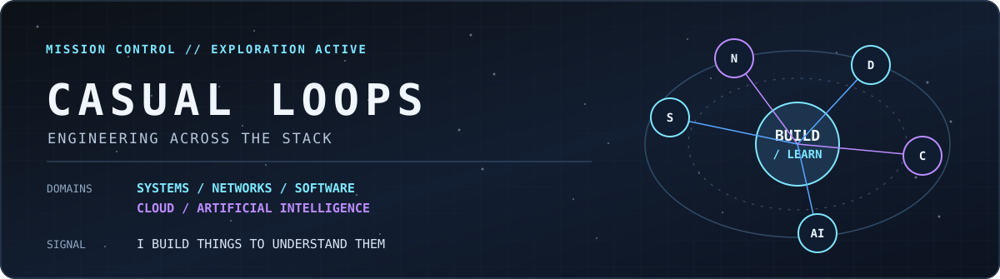
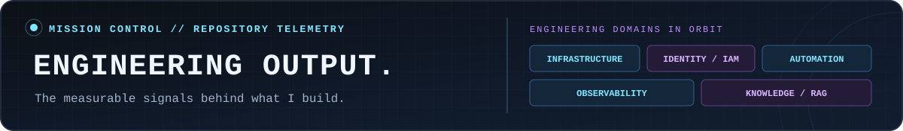
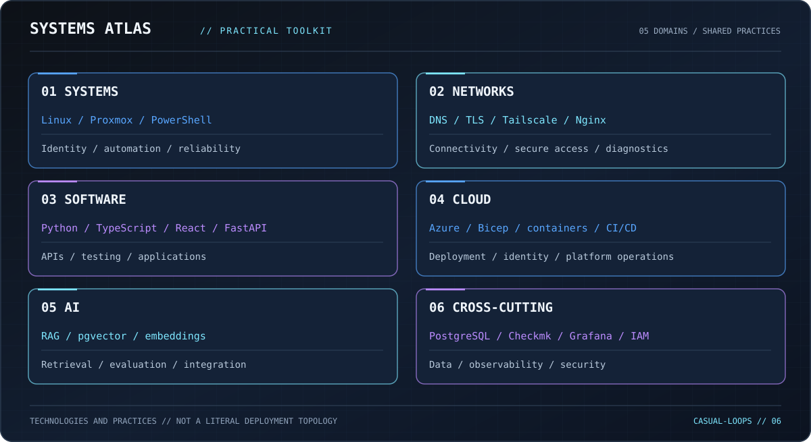
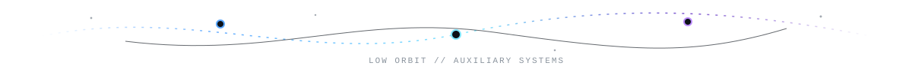

<p align="center">
  
</p>

<p align="center">
  <strong>Systems engineer and administrator building infrastructure, automation, and knowledge systems to understand how complex systems fit together.</strong>
</p>

<p align="center">
  <code>build</code> · <code>document</code> · <code>observe</code> · <code>iterate</code>
</p>

## // signal

I work across systems administration and engineering, with a focus on infrastructure, identity, automation, monitoring, and knowledge systems.

I like projects that make abstract architecture tangible. That usually means building the thing, operating it, documenting it, breaking it, fixing it, and learning what actually matters in the process.

> I build things to understand them.

## // active missions

### 01 · [homelab-infrastructure](https://github.com/casual-loops/homelab-infrastructure)

[](https://github.com/casual-loops/homelab-infrastructure/commits/main)
[](https://github.com/casual-loops/homelab-infrastructure/commits/main)
[](https://github.com/casual-loops/homelab-infrastructure/issues)

A documented private infrastructure environment used as a systems engineering laboratory.

`Proxmox` `Linux` `Docker` `Networking` `TLS` `Tailscale` `Checkmk` `Prometheus` `Grafana` `Backups`

Current work centers on service architecture, observability, secure access, reverse proxy design, recovery, and infrastructure documentation.

### 02 · [knowledge-vault-rag](https://github.com/casual-loops/knowledge-vault-rag)

[](https://github.com/casual-loops/knowledge-vault-rag/commits/main)
[](https://github.com/casual-loops/knowledge-vault-rag/commits/main)
[](https://github.com/casual-loops/knowledge-vault-rag/issues)

A private-first personal knowledge assistant built to understand retrieval-augmented generation from the ground up.

`Python` `FastAPI` `PostgreSQL` `pgvector` `Docker` `Obsidian`

The project connects two interests I keep returning to: systems engineering and knowledge management.

### 03 · [domain-doctor](https://github.com/casual-loops/domain-doctor)

[](https://github.com/casual-loops/domain-doctor/commits/main)
[](https://github.com/casual-loops/domain-doctor/commits/main)
[](https://github.com/casual-loops/domain-doctor/issues)

A public outside-in diagnostic tool for checking DNS, TLS, HTTPS, redirects, and security headers from a single hostname.

`Python` `FastAPI` `DNS` `TLS` `HTTP` `Security`

Current work focuses on safe target validation, SSRF-resistant network checks, and turning low-level infrastructure results into clear operational guidance.

## // telemetry

<p align="center">
  
</p>

<table>
  <tr>
    <td width="56%" valign="top">
      <p><strong>01 // REPOSITORY SIGNALS</strong></p>
      <a href="https://github.com/casual-loops?tab=repositories">
        
      </a>
      <p><strong>02 // CONTRIBUTION CONTINUITY</strong></p>
      <a href="https://github.com/casual-loops?tab=overview">
        
      </a>
    </td>
    <td width="44%" valign="top">
      <p><strong>03 // LANGUAGE FOOTPRINT</strong></p>
      <a href="https://github.com/casual-loops?tab=repositories">
        
      </a>
      <p><sub>Language percentages reflect source code in public, non-fork repositories. They do not measure proficiency.</sub></p>
    </td>
  </tr>
</table>

<p align="center">
  <sub>PUBLIC GITHUB SIGNALS // METRICS UPDATE THROUGH THEIR SOURCE SERVICES</sub>
</p>

## // systems

A conceptual map of the technologies I use across infrastructure, engineering, identity, data, and knowledge work. These are areas of practice, not a diagram of a single deployed environment.

<p align="center">
  
</p>

<details>
  <summary><strong>View the stack as text</strong></summary>

  | Domain | Technologies | What I use them for |
  | --- | --- | --- |
  | Compute & connectivity | Linux, Proxmox, Docker, Nginx, Tailscale | Service hosting, virtualization, traffic routing, and secure access |
  | Engineering & automation | Python, PowerShell, Git, FastAPI | Repeatable administration, tooling, and integration |
  | Data & retrieval | PostgreSQL, SQL, pgvector | Structured data and semantic retrieval |
  | Identity & access | IAM, SSO, Google Workspace, Entra ID | Authentication, authorization, and identity administration |
  | Observability | Checkmk, Prometheus, Grafana | Health monitoring, metrics, and operational visibility |
  | Knowledge systems | Obsidian, RAG, documentation | Connecting technical notes and making information discoverable |

</details>

## // trajectory


```text
→ deeper Linux administration
→ Python for systems engineering
→ PowerShell beyond task automation
→ cloud and identity architecture
→ retrieval-augmented generation
→ infrastructure automation
```

## // operating principles

|  | Principle |
| --- | --- |
|  | Prefer evidence over assumptions. |
|  | Automate repeatable work, document the edge cases. |
|  | Monitoring should explain a system, not merely report that it exists. |
|  | Good infrastructure is understandable infrastructure. |
|  | The fastest way to learn a system is often to own its failure modes. |

<p align="center">
  
</p>

## // off orbit

When I am not working on infrastructure or automation, I keep circling back to astronomy, mathematics, and writing.

I also enjoy taking my dog, Marvel, on adventures at nearby parks, trails, and lakes.

## // comms

If you are here because of one of the projects above, open an issue in the relevant repository. I am always interested in comparing implementation choices, operational lessons, and better ways to design the system.

<p align="center">
  <sub>casual-loops // systems · knowledge · iteration</sub>
</p>
