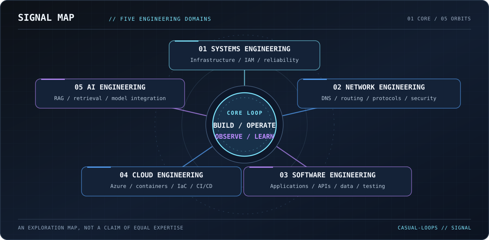
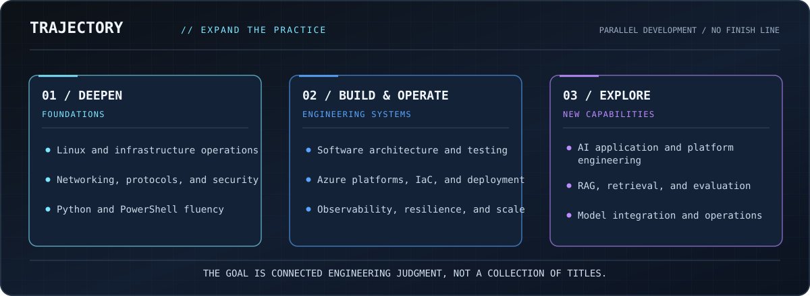
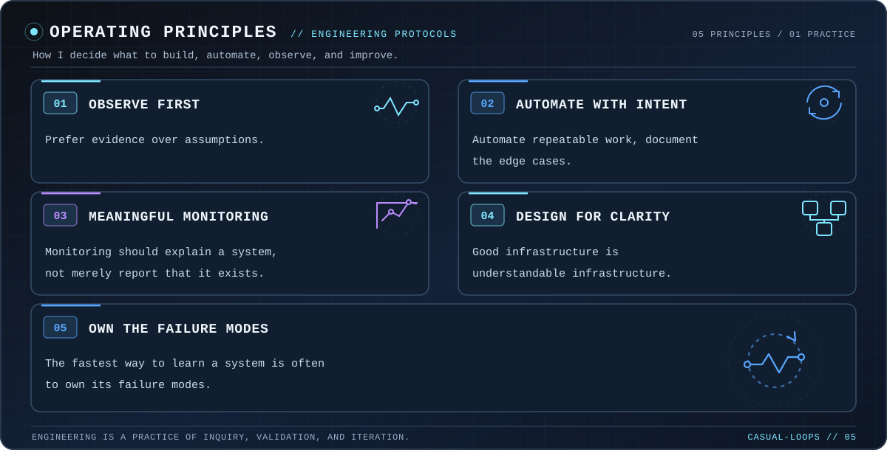

  

  <strong>Engineering across systems, networking, software, cloud, and AI. Building and operating technology to understand how it works.</strong>

  <code>build</code> · <code>document</code> · <code>observe</code> · <code>iterate</code>

## // signal

My professional foundation is in systems engineering and administration, but my interests extend across the technology stack: computer networking, software development, cloud platforms, and artificial intelligence.

I learn by making architecture tangible. I design, build, deploy, operate, document, troubleshoot, and improve systems, using the lessons from one discipline to inform the others. My experience spans infrastructure operations and network diagnostics, application development and cloud deployment, and applied retrieval-augmented generation.

  

The five domains represent complementary areas of practice and exploration, not equal levels of experience or a fixed career ladder.

> I build things to understand them.

## // active missions

### 01 · [homelab-infrastructure](https://github.com/casual-loops/homelab-infrastructure)

A documented private infrastructure environment used as a systems engineering laboratory.

`Proxmox` `Linux` `Docker` `Networking` `TLS` `Tailscale` `Checkmk` `Prometheus` `Grafana` `Backups`

Current work centers on service architecture, observability, secure access, reverse proxy design, recovery, and infrastructure documentation.

### 02 · [knowledge-vault-rag](https://github.com/casual-loops/knowledge-vault-rag)

A private-first personal knowledge assistant built to understand retrieval-augmented generation from the ground up.

`Python` `FastAPI` `PostgreSQL` `pgvector` `Docker` `Obsidian`

The project connects two interests I keep returning to: systems engineering and knowledge management.

### 03 · [domain-doctor](https://github.com/casual-loops/domain-doctor)

A public outside-in diagnostic tool for checking DNS, TLS, HTTPS, redirects, and security headers from a single hostname.

`Python` `FastAPI` `DNS` `TLS` `HTTP` `Security`

Current work focuses on safe target validation, SSRF-resistant network checks, and turning low-level infrastructure results into clear operational guidance.

### 04 · [tapestree](https://github.com/tapestreehq)

A product I'm building for lean IT teams to plan, execute, validate, and learn from operational changes. Its application code is currently private; the public organization profile explains the product vision.

`Next.js` `React` `TypeScript` `Supabase` `Azure` `Bicep` `Docker` `GitHub Actions`

Tapestree brings software engineering and cloud operations together, from multi-tenant data and automated testing to identity, container deployments, and infrastructure as code.

## // telemetry

  

<table>
  <tr>
    <td width="56%" valign="top">
      
<strong>01 // REPOSITORY SIGNALS</strong>

      
      
<strong>02 // CONTRIBUTION CONTINUITY</strong>

      
    </td>
    <td width="44%" valign="top">
      
<strong>03 // LANGUAGE FOOTPRINT</strong>

      
      
Language percentages reflect source code in public, non-fork repositories. They do not measure proficiency.

    </td>
  </tr>
</table>

  PUBLIC GITHUB SIGNALS // METRICS UPDATE THROUGH THEIR SOURCE SERVICES

## // systems

The systems atlas shows the technologies and practices that support my engineering projects. Networking, software, cloud, and AI are distinct interests, while identity, data, security, and observability span the entire stack.

  

  
<strong>View the stack as text</strong>

  | Domain | Technologies and concepts | Application |
  | --- | --- | --- |
  | Systems | Linux, Proxmox, PowerShell, Docker | Infrastructure operations, automation, virtualization |
  | Networking | DNS, TLS, HTTP, Tailscale, Nginx | Connectivity, secure access, network diagnostics |
  | Software | Python, TypeScript, React, Next.js, FastAPI | Application development, APIs, testing |
  | Cloud | Microsoft Azure, Bicep, Azure Container Apps, GitHub Actions | Infrastructure as code, deployments, cloud operations |
  | AI | RAG, embeddings, pgvector, retrieval evaluation | Knowledge retrieval and AI application integration |
  | Cross-cutting | PostgreSQL, IAM, Checkmk, Prometheus, Grafana | Data, identity, observability, operational security |

## // trajectory

My development path is intentionally multidisciplinary. These are parallel directions rather than sequential job titles: strengthen infrastructure and networking fundamentals, build and operate production-minded software and cloud platforms, and develop applied AI engineering capability.

  

The throughline is engineering judgment: understanding the architecture, validating behavior, observing failure modes, and improving reliability as systems grow.

## // operating principles

A few rules I return to when designing, operating, and improving systems.

  

  
<strong>View operating principles as text</strong>

  1. **Observe first:** Prefer evidence over assumptions.
  2. **Automate with intent:** Automate repeatable work, document the edge cases.
  3. **Meaningful monitoring:** Monitoring should explain a system, not merely report that it exists.
  4. **Design for clarity:** Good infrastructure is understandable infrastructure.
  5. **Own the failure modes:** The fastest way to learn a system is often to own its failure modes.

  

## // off orbit

Outside engineering projects, I keep circling back to astronomy, mathematics, and writing.

I also enjoy taking my dog, Marvel, on adventures at nearby parks, trails, and lakes.

## // comms

If you are here because of one of the projects above, open an issue in the relevant repository. I am always interested in comparing implementation choices, operational lessons, and better ways to design the system.

  casual-loops // engineering · exploration · iteration

